# Business model and operating specification

| Metadata | Value |
|---|---|
| Document ID | BM-00 |
| Version / status | 0.1 / proposed discovery baseline; not approved for launch |
| Owner | Product director, with automotive operations lead |
| Reviewers | Finance, legal, security, branch operations, dealer success, product, engineering, QA |
| Last updated | 2026-11-15 |
| Purpose | Define a coherent proposed marketplace operating loop, choices, economics, controls and exceptions for subsequent detailed specifications. |
| Scope | Seller acquisition through transaction closure; stakeholder economics; interfaces to consumer retail and later services. |
| Related material | [Reference evidence](00_RESEARCH_EVIDENCE.md). Research findings are owned there; this document makes proposals, not assertions about the reference company. |

## Executive summary and evidence boundary

**PROPOSED:** Start with a managed, dealer-facing transaction service: obtain a seller request, book and conduct a physical inspection, issue a reviewed valuation, run an eligible-dealer auction, obtain a seller decision, coordinate contracting, track settlement and transfer, and close after evidence review. Humans retain authority over identity, inspection exceptions, valuation overrides, transaction disputes and financial reconciliation. An auction outcome is an offer to be considered, not automatic proof of a binding sale, title transfer or successful settlement.

**DECISION REQUIRED:** No market, contractual model, settlement mechanism, fee schedule, ownership allocation or regulatory permissions have been approved. This document uses a **non-custodial intermediary with externally confirmed direct settlement** as a reversible design scenario for planning, not an approved legal or commercial model. Do not launch or represent it as established policy until local counsel, finance, the payment provider and product leadership approve the model and legal instruments. The platform records obligations and evidence; it does not assert that recording a payment transfers money or title.

**Evidence:** This is an original product proposal. For externally sourced reference-business findings and their dates and limits, see the evidence register. The reference business's public interface and representations do not establish its private systems, actual transaction economics or legal arrangements.

## Objectives, scope and success measures

| ID | Objective | Proposed indicator and definition | Decision / interpretation |
|---|---|---|---|
| BM-01 | Move eligible vehicles from request to completed transaction | Completion rate = transactions marked closed / distinct eligible seller leads in a cohort | Define eligible lead at eligibility review; track calendar periods and cohort maturity separately. |
| BM-02 | Produce credible offers | Offer coverage = auctions with at least one valid bid / finalized auctions | Segment by vehicle class, branch and time; empty auctions are included in denominator. |
| BM-03 | Maintain liquidity and dealer confidence | Qualified bidder participation = distinct eligible dealers with an accepted bid / finalized auction; measure distribution and concentration | Averages can conceal thin categories; do not set a target without baseline. |
| BM-04 | Protect seller choice | Seller decision rate = accepted or rejected offers / valid offers presented before expiry | An absent decision is neither acceptance nor rejection. |
| BM-05 | Close accurately | Reconciled close rate = closed transactions with complete approved evidence and no unresolved monetary discrepancy / closed transactions | Intended target 100%; operations audits sample evidence and ledger linkage. |
| BM-06 | Earn sustainable contribution | Contribution per close = earned net service revenue − attributable variable servicing cost − attributed acquisition cost | Report uncertainty and cohort window; never confuse auction gross value with platform revenue. |

No numerical operating baseline, conversion rate or actual price is known. Proposed measures need instrument definitions, consent review and a minimum observation window before targets are approved.

## Participants, incentives and value exchanges

| Participant | Contributes / obligation | Receives value | Decision rights and data boundaries |
|---|---|---|---|
| Seller / verified owner | Vehicle details, availability, proof of authority, inspection access; must approve contract and transfer in the selected model | Inspection and valuation, access to eligible offers, transaction coordination | Can withdraw subject to applicable agreement; sees own information, report and decision terms. Identity does not alone prove authority to sell. |
| Dealer organization | Eligibility documents, staff authorizations, bids, accepted payment and transfer obligations | Qualified opportunities, consistent inspection evidence and transaction support | Only approved and currently eligible organization members can bid within their assigned authority. No access to other bidders' identities or seller sensitive documents unless a lawful purpose and access decision allow it. |
| Consumer buyer, later | Purchase inquiry, identity and payment information as applicable | Search, disclosed vehicle condition and purchase coordination | Consumer inventory and active dealer-auction inventory are distinct. A visible offer must not promise a vehicle that is unavailable. |
| Branch operations | Capacity, check-in, document collection and vehicle handover coordination | Work queue and operational controls | May schedule and check documents within branch scope; cannot self-approve restricted financial overrides by default. |
| Inspector and inspection reviewer | Findings, evidence, reviewer judgment and correction history | Work assignments and clear inspection standards | Inspector creates a versioned draft; authorized reviewer approves publication. Corrections preserve previous report versions and provenance. |
| Pricing analyst / approver | Market inputs, valuation recommendation, documented override | Comparable evidence, model guidance and audit trail | An indicative valuation is not a guaranteed sale price. Overrides require a reason and, above a configurable threshold, separate approval. |
| Auction operator | Auction schedule, published terms, exception handling | Auction monitoring and escalation tools | Cannot silently alter accepted bids or a finalized outcome; cancellation and correction require defined policy and audit. |
| Finance / reconciliation | Fee quote, obligation tracking, evidence review and dispute holds | Reconciled records and exception queue | Sensitive bank detail changes and material adjustments require an independent reviewer. Finance records evidence; a provider or bank remains source of funds movement. |
| Legal / compliance | Terms, authorization, model and jurisdiction review; dispute decisions | Review queues and evidence provenance | Determines whether a transaction may progress under applicable law; does not have blanket access to financial credentials. |
| Customer support | Inquiry handling, status communication and escalations | Case timeline and approved templates | Least-privilege read access; cannot change price, payment or legal documents without separately assigned authority. |
| Carrier / logistics partner, later | Pickup, custody and delivery evidence | Dispatch and service revenue where contracted | Access limited to assigned delivery and minimum contact/location data; no claim of transfer of title by delivery alone. |
| Payment provider, bank, escrow agent or lender, as applicable | Regulated payment, custody or financing service and authoritative status | Contracted service fees or partner economics | External party's role and authorization depend on signed agreement, jurisdiction and selected model. A lender makes its own credit decision. |
| Platform operator | Coordination, staff, software, controls, support and agreed disclosures | Approved fees or partner revenue | Responsible for controls only to extent assumed under contracts and law; product labels cannot settle legal classification. |

## Business model alternatives and decisions

### BM-07 — Transaction relationship

| Alternative | Vehicle ownership and sale | Where revenue may arise | Main trade-off / gating |
|---|---|---|---|
| Intermediary / broker | Seller and buyer contract directly; platform coordinates according to its mandate | Disclosed service or success fee | Lower inventory exposure but enforceable mandates, consumer protections and agency duties require legal review. |
| Inventory principal | Platform acquires and resells a vehicle | Resale spread, permitted services | Requires capital, title, inventory aging, warranty and tax controls; never infer a seller-to-dealer direct relationship. |
| Dealer-direct | Approved dealer purchases directly; platform provides marketplace and operational services | Agreed dealer or seller fee | Obligation and liability allocation, bid enforceability and disclosure must be agreed. |
| Managed broker | Brokered deal with coordinated inspection, documents and permitted service partners | Success fee and permitted ancillary services | Greater service control, staff and operating cost; must avoid implying a guarantee that contracts do not provide. |

**PROPOSED:** Use the non-custodial intermediary scenario for MVP specification because it allows the basic service loop to be modeled without assuming platform inventory or custody. Whether the seller or dealer pays a fee, whether bidding creates binding obligations, and exactly who signs with whom remain **DECISION REQUIRED**. Reassess for each market; product configuration is not a substitute for licensing or legal analysis.

### BM-08 — Funds movement and settlement

| Mechanism | Actual movement of funds | Platform records | Launch prerequisite and control |
|---|---|---|---|
| External direct settlement (planning scenario) | Buyer pays seller outside the platform through an agreed channel | Expected obligation, payment assertions, independently verifiable evidence, reconciliation and exceptions | Parties and legal approve evidence standard; no automatic close from a customer assertion alone. |
| Payment-provider mediated | Contracted provider accepts and routes or facilitates payment under its own agreement | Provider transaction ID, states, amounts, idempotent callbacks, reconciliation | Verify provider capabilities, liability, settlement finality, refunds, dispute procedures and regulated roles. |
| Licensed / otherwise approved escrow | Approved third party holds and releases under escrow terms | Escrow reference, conditions, release and confirmation evidence | Verify escrow legality and provider; platform must not describe itself as escrow agent unless authorized. |
| Platform collection and disbursement | Platform receives funds and makes a subsequent payment | Separate obligations and ledger events, bank reconciliation, customer funds controls | **Excluded from MVP planning scenario**; subject to explicit commercial decision, licensing, legal, treasury and operational approval. |

A deposit, hold, refund, credit facility and fee collection each require separately approved terms. System configuration must identify debtor, creditor, amount, currency, due date, settlement method and evidence authority; fields do not create legal rights. Partial payment remains partial; overpayment or a mismatch creates an exception, not automatic closure. Financial events are append-only adjustments with actor, reason, timestamp and linked evidence; operational records are not a replacement for a general ledger.

### BM-09 — Non-negotiable decision register

| Decision | Priority / owner | Options and impact | Blocking point |
|---|---|---|---|
| Target market and launch jurisdiction | P0 / sponsor + legal | Market, place of contracting, tax and transfer processes determine all other choices | Before legal terms, financial design or launch commitments. |
| Contracting and ownership model | P0 / sponsor + legal + operations | BM-07 options; affects title, counterparty, liability and revenue recognition | Before final contract, acceptance and closure rules. |
| Money movement and evidence of finality | P0 / finance + legal | BM-08 options; affects permissions, partner contracts and reconciliation | Before financial build is accepted or live payment is handled. |
| Auction effect and seller/dealer obligations | P0 / legal + commercial | Offer versus binding bid, offer expiration, cancellation, reserve disclosure, default | Before auction terms and production bidding. |
| Fees, tax and responsibility | P0 / finance + commercial + legal | Payer, basis, rate, caps, refunds, tax and recognition triggers | Before quoting or collecting fees. |
| Title transfer and closure evidence | P0 / legal + operations | Documents, authority, timing, custodian and ownership status | Before closure can be approved for a market. |
| Inspection, defects and warranty commitments | P0 / operations + legal | Scope, limitations, corrections, claim window and remedy | Before report publication or promises to a customer. |
| Identity verification and retention | P0 / security + legal | Required documents, provider, acceptable evidence, lawful basis and retention | Before collecting sensitive production documents. |
| Dealer screening, bids and controls | P1 / dealer success + risk | Approval, authority, increment, restriction and default policies | Before accepting dealer applications and bids. |
| Consumer sales and finance | P1 / product + legal + finance | Inventory channel, financing provider, eligibility and disclosure | Before those later-phase features launch. |

## Proposed revenue and cost model

Revenue opportunities below are hypotheses, not statements about the reference company or approved prices. All require competition, tax, consumer protection and contract review; payment for a referral can be restricted in some jurisdictions.

| Mechanism | Plausible payer / pricing unit | Tentative phase | Key validation and risk |
|---|---|---|---|
| Transaction service fee | Seller or buyer; fixed, percentage or tier per completed eligible transaction | MVP candidate | Approve triggering event, disclosed tax-inclusive price, cap/floor, withdrawal and refund rules. |
| Dealer subscription | Dealer organization; recurring term or seat | Phase 2 candidate | Validate enough eligible volume; avoid implying guaranteed supply. |
| Inspection service | Seller or contracting partner; per inspection | Later or explicit pilot | Avoid charging twice without clear disclosure; define scope, cancellation and remedy. |
| Premium dealer tooling | Dealer; per organization or seat | Later | Show incremental value without manipulating fair auction access. |
| Financing referral | Contracted lender; disclosed referral or service payment where lawful | Later | Conflicts, consent, broker licensing, underwriting independence and disclosure. |
| Logistics / warranty services | User or contracted partner; per service or coverage | Later | State actual provider, terms, eligibility and liability. |
| Featured listings / data services | Dealer or licensed business; per placement or product | Later | Transparent labels; aggregated data quality, privacy and competitive fairness. |

Acquisition costs include paid media, referral payments and attributable sales labor; servicing costs include branch rent and staff, inspection tools, call center, auction support, payment-provider charges, document verification, legal, disputes and support. Platform/cloud, product development, security, insurance, corporate overhead and depreciation may be fixed or allocated depending on the costing policy. Financing, inventory and custody add capital, funding, loss and regulatory costs; none is assumed in the MVP planning scenario.

### Fee quote and accounting controls

**PROPOSED:** Version a fee policy and record the applicable version with each quote. Produce a line-item quote before the user makes a binding commitment: transaction price, fee basis, rate or fixed amount, taxes, third-party charges, total and payer. Currency is an ISO 4217 code; monetary values use integer minor units where supported and an explicitly defined rounding policy. Recalculate only with a new version and disclosed approval; preserve the earlier quote. Finance determines when a fee is earned and recognized under applicable accounting rules. Booking an inspection, accepting a bid, raising an invoice, receiving cash and recognizing revenue are separate events.

The policy must state treatment of cancellation, unsuccessful auctions, defaults, chargebacks, taxes, price changes and refunds before quoting live transactions. No penalty, commission or warranty is inferred from a hypothetical workflow.

## Illustrative unit economics and sensitivity

**PROPOSED illustration only, not a forecast or market benchmark.** Values are made-up monthly inputs in a single unspecified currency; tax, seasonality, bad debt and revenue timing are excluded. No actual target, market size or verified cost is implied. These inputs support a sanity check, not a budget.

| Input or calculation | Illustration |
|---|---:|
| Paid and attributed acquisition cost | 4,500 |
| Distinct leads / booked / inspected / auctions / seller accepts / closed | 300 / 210 / 160 / 110 / 77 / 70 |
| Lead-to-close yield | 70 / 300 = 23.33% |
| Earned net service revenue per closed transaction | 300 |
| Attributable variable servicing cost per closed transaction | 120 |
| Acquisition cost per closed transaction | 4,500 / 70 = 64.29 |
| Contribution per close after acquisition | 300 − 120 − 64.29 = 115.71 |
| Monthly contribution after acquisition | 70 × (300 − 120) − 4,500 = 8,100 |
| Illustrative fixed operating cost | 10,000 |
| Monthly operating result under these assumptions | 8,100 − 10,000 = −1,900 |
| Break-even completed transactions per month at constant acquisition cost per close | ceil(10,000 / 115.71) = 87 |

The break-even calculation assumes linear acquisition and servicing costs, constant unit yield and no capacity step, financing costs, taxes or timing effects. Costs spent on all leads—including unsuccessful ones—are included in acquisition cost per close; variable service cost per close is a simplifying blended allocation and must be recalculated when failed inspections or auctions consume material resources.

| Lead-to-close yield | Assumed acquisition cost per lead | Acquisition cost per close | Contribution per close | Approximate break-even closes |
|---:|---:|---:|---:|---:|
| 10% | 15 | 150 | 30 | 334 |
| 23.33% | 15 | 64.29 | 115.71 | 87 |
| 30% | 15 | 50 | 130 | 77 |

Sensitivity holds fee, variable cost and fixed overhead constant, so it is not a scenario forecast. Review every cohort's age and status before comparing yields: a recent cohort may simply be incomplete. For dealer lifetime value, proposed definition is discounted expected contribution from a dealer's retained transactions, less acquisition and retention costs; estimate retention and margins from observed cohorts, not assumed revenue. Review concentration (share of accepted bids and closes attributable to the largest dealers), empty-auction rate and repeat participation alongside total marketplace volume.

## Operating process and controls

### OP-01 — End-to-end process

```mermaid
flowchart LR
  S[Seller submits request] --> C[CRM eligibility and consent]
  C --> B[Branch books and checks in]
  B --> I[Inspector records findings]
  I --> R[Reviewer approves report]
  R --> V[Pricing proposes indicative value]
  V --> A[Eligible dealers bid]
  A --> D[Seller considers valid offer]
  D -->|accepts subject to terms| K[Legal coordinates contract]
  D -->|declines or expires| X[Close without sale or approved follow-up]
  K --> F[Finance tracks and reconciles settlement]
  F --> T[Operations verifies transfer and handover]
  T --> Z[Authorized closure with evidence]
```

The diagram is an operating hypothesis, not a definitive legal sequence. The contract may prescribe a different ordering of payment, handover and ownership transfer. Do not require a participant to surrender custody before agreed protections are fulfilled.

| Step | Responsible actor / trigger | Reads and writes | Normal outcome, exception and recovery |
|---|---|---|---|
| OP-02 Capture and qualify | Seller submits; CRM agent reviews | Contact/consent, vehicle attributes, deduplication candidates; creates seller request and review notes | Eligible request proceeds to booking. Unsupported vehicle is politely declined or queued for manual review. Possible duplicate is reviewed, not automatically merged; contact verification failure permits safe retry. |
| OP-03 Book and check in | Seller or scoped branch agent selects a slot | Branch schedule, working hours, capacity; writes booking, customer notice, attendance | Reserve capacity atomically and confirm only after reservation. If the slot is taken, offer alternatives; no-show, cancellation and reschedule release capacity under policy. Avoid exposing other customers' appointments. |
| OP-04 Verify authority and inspect | Branch checks documents; inspector records evidence | Identity/authority evidence, checklist version, vehicle identifiers, photos and findings; creates inspection draft | Reviewer verifies completeness and approves report version. Missing or inconsistent identity blocks downstream publication pending review; inability to inspect an item is explicit, never a pass. Disagreement opens a correction/dispute case preserving prior versions. |
| OP-05 Value and publish | Pricing analyst sees approved report and market evidence | Approved report, comparable evidence, methodology version, valuation range and explanation | Authorized override requires reason and independent approval when policy requires; stale or inadequate data forces manual review or abstention, not fabricated precision. Seller-facing valuation is indicative. |
| OP-06 Auction | Authorized operator schedules approved vehicle; eligible dealers place bids | Published terms, bidder eligibility, bid submissions, server time, accepted bid sequence and closing snapshot | Validate eligibility and increments on the server. Record authoritative ordering and results. Duplicate submissions return the original result; simultaneous bids may not both become highest for the same increment. An outage triggers an operator-approved pause, cancellation or recovery under published terms; do not silently alter accepted bids. Detailed mechanics require a dedicated auction specification and legal decision. |
| OP-07 Seller decision | Seller is shown an offer and complete terms | Final auction result, offer version, expiration, seller decision and time | Record explicit acceptance or rejection; absent response expires under agreed terms. No bids, reserve not met or decline is handled as unsuccessful; relisting or negotiation is optional only after a policy decision and required consent. |
| OP-08 Contract and obligation | Legal coordinates after offer acceptance subject to applicable terms | Parties, approved terms, document versions, signatures, quote and obligations | Missing signatures, changed terms, identity mismatches or legal holds block progress. Amendment creates a new version and obtains required approvals. The legal effect of acceptance and signatures is market-specific. |
| OP-09 Settlement and reconciliation | Debtor pays through approved method; finance reviews | Obligation, amount/currency, external payment reference, evidence, reconciled balance and discrepancy | Duplicate or delayed confirmation cannot create a second payment. Partial funds, payee mismatch, provider outage or contested evidence hold completion and create a case; retry status checks safely and reconcile to the authoritative provider/bank source. Do not store raw card credentials. |
| OP-10 Transfer and handover | Authorized parties arrange transfer and handover under contract | Transfer requirements, submitted and approved evidence, custody/handover record, condition | Separate physical custody, registered title and payment finality. A missed appointment, missing proof or damage opens an operations/support case; parties are notified using approved communication templates. |
| OP-11 Close and retain | Authorized operations staff confirm all required evidence | Contract, obligations, reconciliation, transfer/handover evidence, open cases and approvals | Close only when policy-required conditions are satisfied or an authorized exception is recorded. Missing evidence or unresolved monetary discrepancy prevents ordinary closure. Retention and deletion follow approved legal schedules; preserve lawful holds. |

Every privileged change records who acted, when, what changed, a reason and relevant evidence; access to identity documents and payment details is scoped to purpose and audited. Customer notices disclose only information required for the recipient's role. Notifications are retried through the selected provider and failure appears in the operations queue; delivery of a notice does not itself complete a legal act.

### OP-12 — Exceptions and ownership

| Trigger | Immediate containment / user-visible behavior | Recovery owner and next action |
|---|---|---|
| Seller disputes inspection | Do not overwrite the approved report or imply the dispute is resolved. Tell the seller the report is under review. | Inspection supervisor reviews evidence, obtains a second inspection when policy permits, issues a versioned correction or a reasoned decision. Pause an auction if the report may materially mislead. |
| Duplicate or conflicting vehicle authority | Avoid publishing until identity and authority are established. Tell the applicant additional review is required. | Branch and legal review evidence; merge or close records only with an auditable decision. |
| Dealer loses eligibility during an auction | Prevent further unauthorized bids and retain the historical bid audit. Do not secretly erase prior bids. | Auction operations and legal apply published policy to existing bids, notify affected parties as appropriate and record the determination. |
| Highest bidder defaults | Mark obligation disputed or overdue; do not substitute another buyer silently. | Dealer operations and legal follow signed terms, assess restriction and remedies, and obtain approvals before any new offer or relist. No penalty is assumed. |
| Seller rejects or does not respond | State whether offer was rejected or expired; do not represent it as accepted. | CRM closes the attempt or offers a consent-based follow-up. Any relisting is separately authorized. |
| Payment is delayed, partial, disputed or impossible to verify | Keep settlement pending or in exception; show a neutral status rather than claiming funds arrived. | Finance contacts parties or provider through authorized channels, matches evidence and resolves or escalates. Never request full payment credentials through an ad hoc message. |
| Bank details change during settlement | Hold pending payment initiation and record the request without displaying full sensitive details to unrelated staff. | Independently verify through approved channel, require dual review, audit before release, notify the affected party. |
| Ownership transfer or handover delayed | Preserve separate payment, custody and title statuses; no automatic successful closure. | Legal and operations coordinate the relevant authority, contract deadlines, party notifications and approved remedy. |
| Disputed defect or transport damage | Preserve time-stamped evidence and existing report versions; do not promise compensation. | Support opens a case; inspection, carrier, insurer and legal examine contract and evidence before an authorized remedy. |
| System outage near auction close | Display service interruption and do not show an invented winner. Protect bid log and capture authoritative timeline. | Incident commander and auction operations restore and reconcile, then apply prepublished recovery terms and communicate the decision. |

## Risks, controls and validation plan

| Risk | Consequence | Proposed control | How to verify |
|---|---|---|---|
| Thin liquidity or concentrated buyers | Weak offers and seller churn | Observe bid coverage and dealer concentration by segment; recruit and approve more relevant dealers | Weekly cohort review and distribution of unique bidders per auction. |
| Vehicle misrepresentation or incomplete inspection | Dispute, injury or loss | Evidence-backed checklist, explicit uninspected items, independent report review and correction history | Sample reports and verify that missing items cannot be marked passed without evidence. |
| Bid race, duplicate submission or outage | Incorrect result and loss of trust | Authoritative bid ordering, deduplication, immutable audit and tested failure policy | Simulate simultaneous, duplicated and delayed bids and compare final result to accepted sequence. |
| Premature transaction closure | Unpaid seller or incomplete title transfer | Distinct settlement and transfer statuses; evidence-based closure and independent financial review | Negative tests demonstrate that incomplete evidence prevents closure. |
| Unauthorized seller, dealer or employee | Fraud, wrongful access or unauthorized sale | Verify authority, least-privilege scope, approvals for financial changes and audit | Access tests, dual-review audit and periodic entitlement review. |
| Unclear legal responsibility | Misleading promises, unenforceable commitments or regulatory exposure | BM-09 decisions, market-specific counsel review, explicit terms and provider contracts | Signed decision and counsel review before market launch. |
| Unreliable pricing or nonrepresentative comparables | Seller mistrust and pricing loss | Explain confidence, compare to realized outcomes, permit reasoned override and abstain on insufficient data | Back-test by vehicle cohort and monitor estimate error and coverage. |
| Personal document exposure | Privacy and security harm | Data minimization, scoped encrypted storage, access audit and jurisdiction-specific retention | Access-denial tests, access log review and deletion/hold tests. |

## Acceptance criteria and review

1. A reviewer can identify all contracting parties, who may make each material decision, and which decisions remain unapproved without inferring the platform owns a vehicle or holds funds.
2. A sample request can traverse OP-02 through OP-11, with a responsible actor and recorded data at each step; unsuccessful offers, no-show, identity mismatch, outage, default, disputed inspection and payment discrepancy have an owner and recovery path.
3. A completed transaction cannot be represented as reconciled solely because a bid won, the seller accepted, or a participant asserted payment; the selected market's approved settlement and transfer evidence must be present.
4. Every customer-facing fee quote is traceable to an approved policy, payer, currency, amount, tax treatment and triggering conditions. No particular fee or penalty is authorized by this proposal.
5. Finance can recompute the illustrative contribution and break-even arithmetic from the stated assumptions. Finance and legal must approve real accounting, tax and market assumptions before forecast publication or launch.
6. Product, operations, finance, legal, security and QA review the P0 decisions in BM-09 before their respective acceptance gates. This document alone is not a complete implementation specification.

## Open questions and next decisions

The business sponsor must select the first market and contracting/settlement model, identify actual provider candidates and approve the fee, dealer eligibility, inspection representation and legal transfer policies. Operations must validate that branch staffing, customer support and an evidence-based reconciliation process can run the proposed loop. Product and engineering must derive detailed workflow states, API contracts, permissions, scenario tests and measurable service targets from approved decisions. Independent research must establish competitor and reference-business facts; no numerical industry claim in this proposal should be treated as verified.
