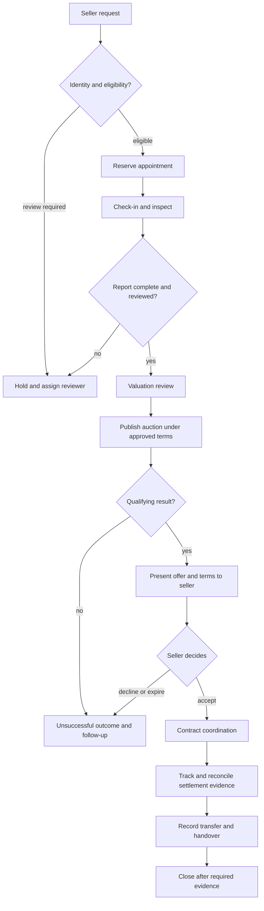

# Business process flows

| Metadata | Value |
|---|---|
| Document ID | 03/04_BUSINESS_PROCESS_FLOWS |
| Version / status | 0.1 / proposed; awaiting review |
| Owner | Product and operations leadership |
| Reviewers | Legal, finance, design, architecture, security and QA as applicable |
| Last updated | 2026-11-15 |
| Scope | Business process flows; English-first automotive marketplace documentation |

## Main managed-sale flow

**PROPOSED:** This is a logical flow, not legal sequence. A market's contract can require payment, title and custody steps in a different order. No implicit payment transfer occurs when a record is updated.

## Financial exception flow
When a claim of payment is received, finance matches currency, amount, payee, reference and authoritative evidence against an obligation. If any are inconsistent or unavailable, mark discrepancy, retain evidence and assign reviewer; independently verify changes to bank details. Record partials and adjustments without overwriting history. Only authorized finance review may confirm matched status. An unresolved discrepancy blocks ordinary close; legal and approved contract determine remedy.

## Inspection correction and auction outage
A material report dispute creates a controlled hold, preserves the original report, assigns a supervisor and issues a new version if approved. Auction users receive policy-based notice; no bid is silently deleted. An outage captures incident timeline and accepted-bid ledger, stops invalid actions and applies the prepublished recovery rule after authorized review. Until DEC-04 is approved the exact pause, cancel or extension behavior remains a decision, not an automatic rule.
