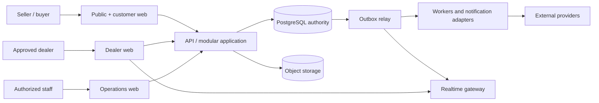

# Architecture Overview

| Metadata | Value |
|---|---|
| ID / version | 08/01_ARCHITECTURE_OVERVIEW / 0.1 |
| Status | Proposed specification; no stakeholder approval |
| Owner / reviewers | Architecture and data leads / product, security, operations, QA |
| Updated | 2026-11-15 |
| Scope | Architecture Overview; jurisdiction-dependent policy decisions remain open. |

## Purpose and context
**PROPOSED**: a modular monolith serves the foundational managed seller-to-dealer process; domain-owned modules share one transactional PostgreSQL cluster but expose narrow application interfaces, not cross-module table writes. A separately scaled stateless fan-out gateway handles WebSocket subscriptions without deciding bids. Physical decomposition is deferred until operational evidence justifies its cost. See [domain boundaries](04_DOMAIN_BOUNDARIES.md) and [auction consistency](../12_AUCTION_AND_TRANSACTION_SYSTEMS/03_AUCTION_CONCURRENCY.md).

The database owns binding state, outbox and audit records in the same transaction as domain changes; projections and notifications may lag. The client never decides time, rank or payment clearance. Reads of accepted bid and auction close use authoritative state, not Redis, a search index, WebSocket delivery or an analytics warehouse. Domain events are at-least-once; consumer inboxes deduplicate. All external actions use provider idempotency keys and reconciliation.

**Failure behavior:** on loss of authoritative database or trustworthy time, reject bids without acknowledgement and suspend closing; reconnect clients must fetch snapshot. Failed provider actions remain pending, visible to operators with ownership and a retry limit. Never infer completed transfer from an API timeout. **Security:** object, tenant and branch scopes are checked server-side on every request and subscription; privileged changes require reasons, audit and stronger approval according to policy. **Acceptance:** duplicate commands yield one durable outcome; accepted bids survive gateway failure; no notification failure reverses a committed bid; unauthorized auction reports remain inaccessible. Production launch remains blocked by DEC-01–DEC-07 in the master index.
