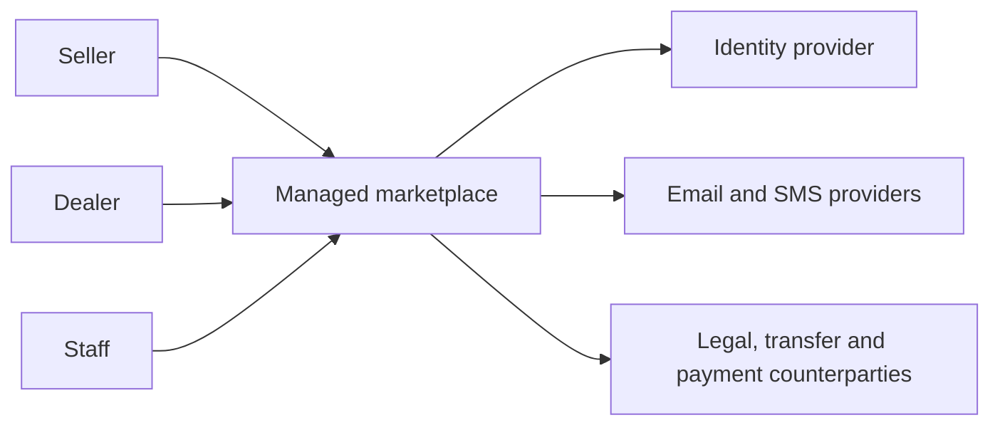
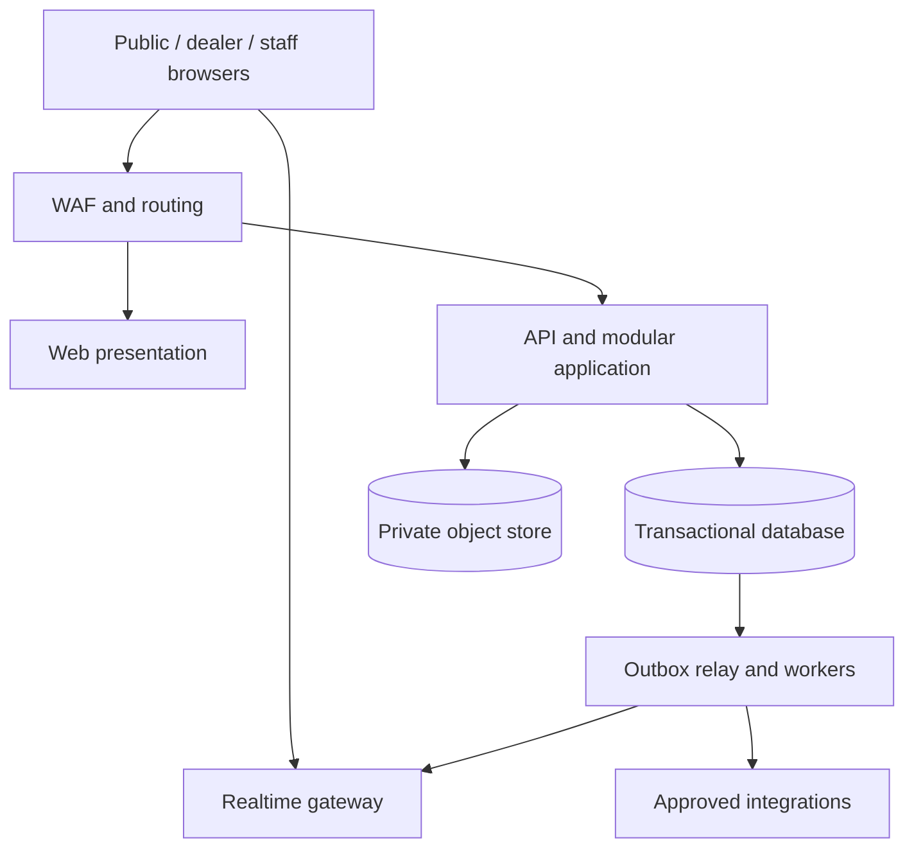
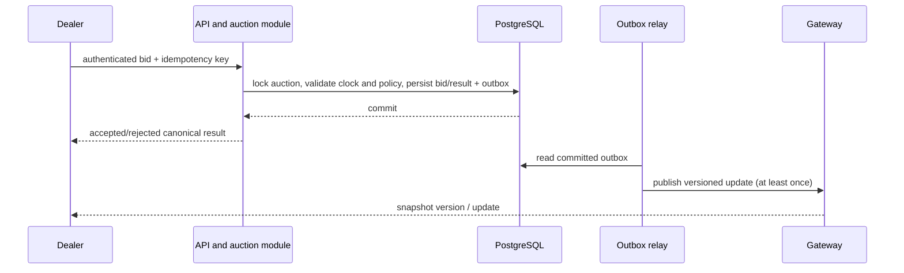
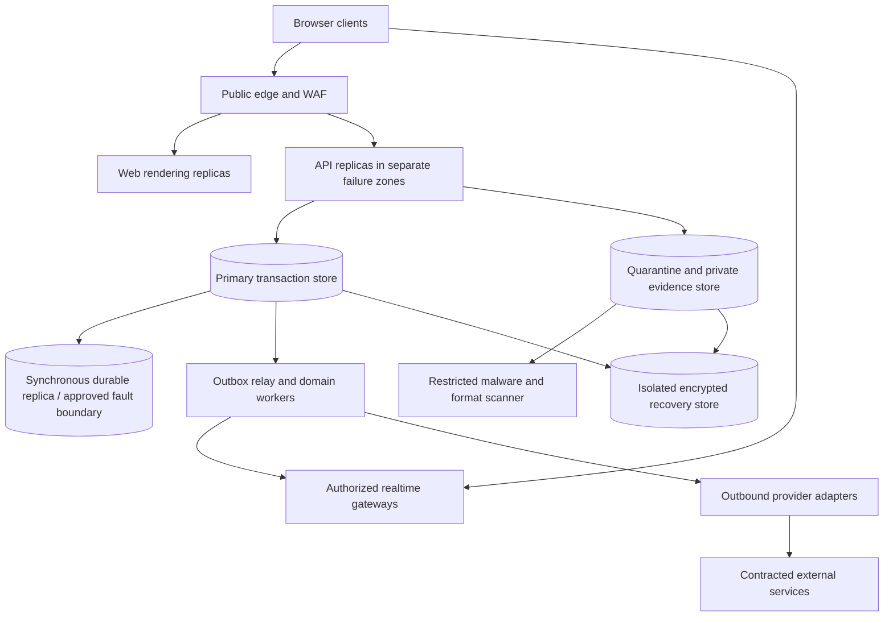
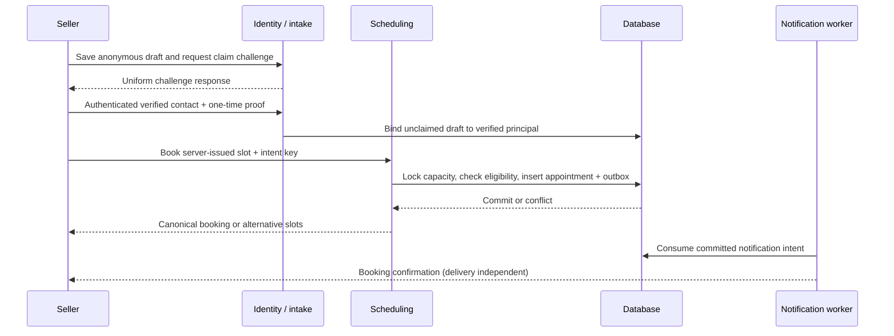
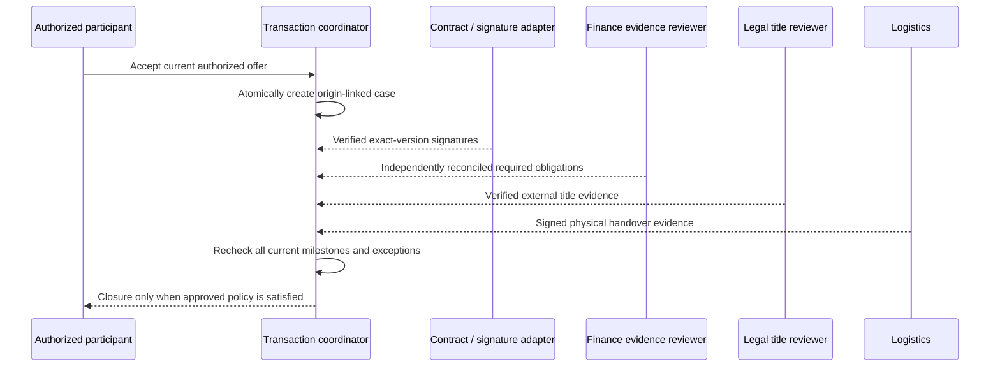
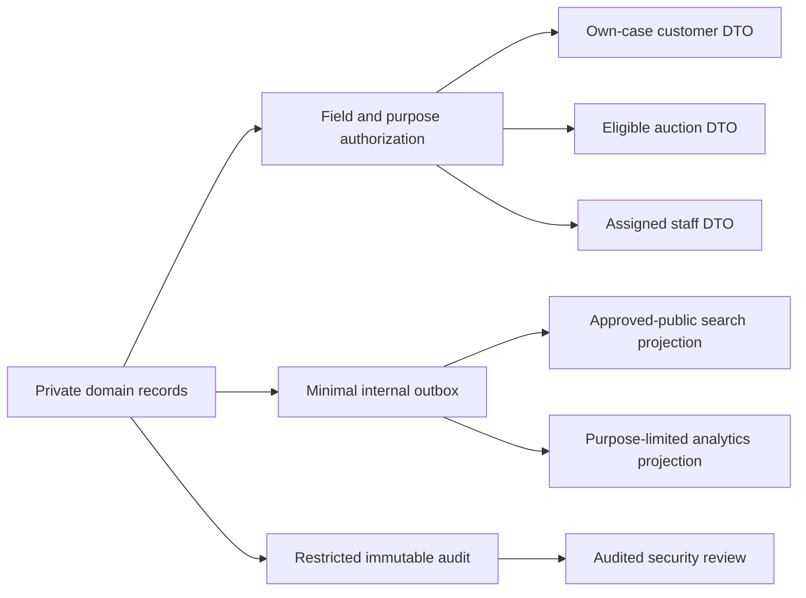

# C4 Diagrams

| Metadata | Value |
|---|---|
| ID / version | 08/03_C4_DIAGRAMS / 0.3 |
| Status | Proposed specification; no stakeholder approval |
| Owner / reviewers | Architecture and data leads / product, security, operations, QA |
| Updated | 2026-11-15 |
| Scope | C4 Diagrams; jurisdiction-dependent policy decisions remain open. |

## C4 context

## Containers and trust

## Auction components

Inferred infrastructure is not a reference-business observation. Browser, external provider and storage are separate trust boundaries. Gateway is not an authority. Lost notifications are recovered by the snapshot and revision protocol. The following additional sequences define the identity, inspection, contract, payment and delivery boundaries; no diagram implies money or vehicle custody.

## Deployment and failure domains (proposed)



Only edge, presentation and explicitly approved provider ingress are externally reachable. Database, workers, storage and scanning run on restricted networks and service identities. Region, provider, availability zones and data residency are deployment decisions tied to market approval; this diagram commits to isolation/durability behavior, not a vendor. A read replica may serve lag-tolerant analytics but not bid admission or seller acceptance.

## Intake identity and booking



## Inspection publication and correction

```mermaid
sequenceDiagram
    participant I as Assigned inspector
    participant R as Independent reviewer
    participant A as Inspection application
    participant D as Database / evidence metadata
    participant Q as Auction safety workflow
    I->>A: Template-pinned findings and clean evidence IDs
    A->>D: Save versioned revision and audit
    R->>A: Review exact revision, publish with ETag
    A->>D: Check author differs, completeness, checksum; publish + outbox
    D-->>R: Published immutable revision
    R->>A: Material correction with reason
    A->>D: Preserve original, create successor and set auction safety hold atomically
    A->>Q: Committed correction event
    Q->>D: Read committed hold and coordinate authorized resolution
```

Publication must not race with a material correction and bid admission. The auction stores a safety-hold/valid-report guard checked under its lock; correction marks affected auction hold atomically within the same modular database transaction before acknowledging a material correction. The asynchronous event distributes the fact but is not the sole safety barrier. If cross-service extraction later prevents this transaction, a new reviewed consistency protocol is required before enabling that architecture.

## Transaction coordination without implied custody



## Data flow and disclosure boundaries



Search and analytics apply their own explicit allowlists and deletion/tombstone propagation. Neither projection is used to authorize a bid, claim funds, confirm title or close a transaction. Every arrow crossing a trust boundary has a scoped identity, schema, timeout and observable failure owner.
