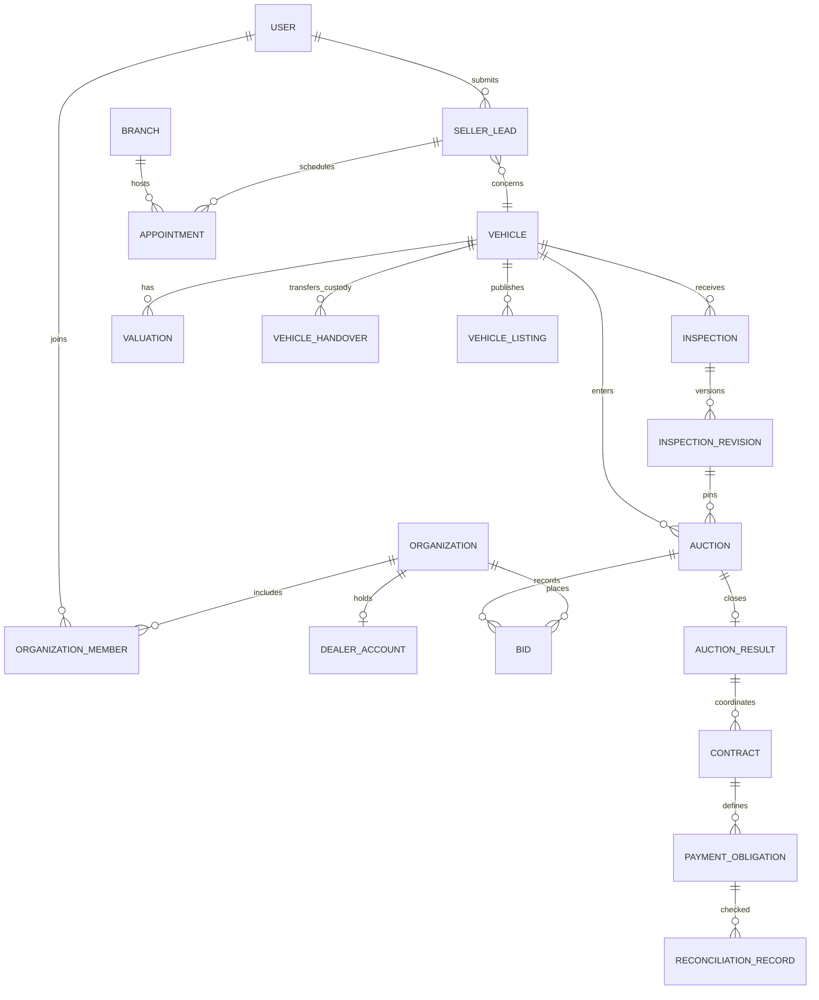
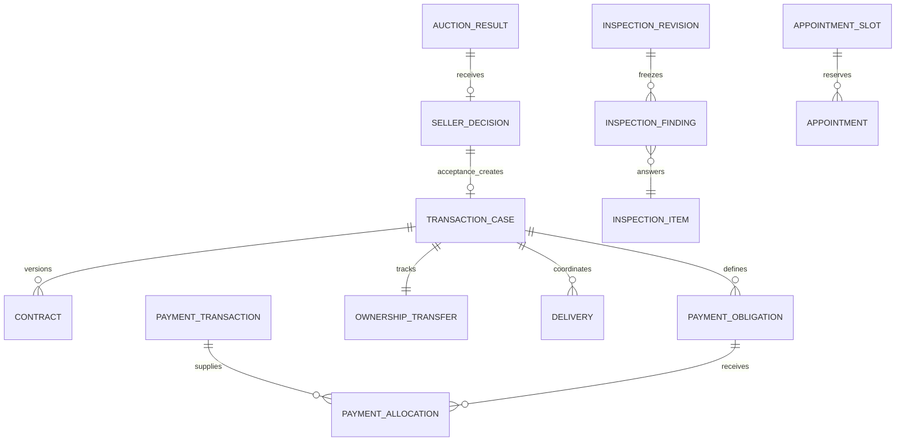

# Entity Relationship Diagram

| Metadata | Value |
|---|---|
| ID / version | 09/02_ENTITY_RELATIONSHIP_DIAGRAM / 0.1 |
| Status | Proposed specification; no stakeholder approval |
| Owner / reviewers | Architecture and data leads / product, security, operations, QA |
| Updated | 2026-11-15 |
| Scope | Entity Relationship Diagram; jurisdiction-dependent policy decisions remain open. |

## Conceptual relationships

Cardinality is conceptual: contract and obligation creation depends on the approved legal model, while a vehicle may appear in multiple auctions at different times but must not have multiple concurrently active auctions unless specifically approved. A published inspection revision is immutable and may be shared by multiple authorized auctions. Sensitive source documents have separate protected storage and are not embedded in public search records.

## Transaction and evidence relationships

An accepted current decision creates at most one transaction case; rejection creates none. Allocation totals cannot exceed verified payment and must match currency. Findings are revision-owned. Contracting parties, retention and exact legal finality remain approved-policy inputs.
