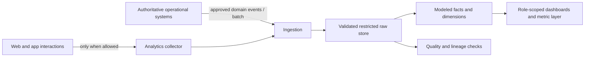

# Analytics architecture

**ID:** 17/01_ANALYTICS_ARCHITECTURE · **Version:** 0.1 · **Status:** PROPOSED, subject to privacy, finance and product approval · **Owner:** Head of data · **Reviewers:** Analytics, security, legal, finance, product · **Updated:** 2026-11-15

## Purpose and boundary
Measure the proposed seller-to-dealer journey, branch operations and later consumer/finance services while separating operational business facts from consent-dependent behavioral analytics. No product metrics, vendors, actual pipelines or approvals exist yet. Jurisdiction, legal basis, retention, consent and cross-border transfer are unresolved decisions in the master discovery register.

## Data flow and identity
Operational systems remain the source of truth for consent, lead qualification, accepted bid, seller decision, contract, verified settlement, title transfer and closure. Behavioral events may be lost, blocked or denied and must never determine auction/transaction status. Ingestion validates version, timestamp, event ID, consent purpose and field allowlist, quarantines malformed payloads, deduplicates by source+event ID, preserves event and receipt time and records lineage. Use restricted random pseudonymous session identifiers only where permitted; an account identifier is separately scoped and never derived from email/phone. Join only when documented legal basis and purpose allow; consent withdrawal stops future optional collection and triggers deletion or suppression according to policy, without deleting legally required operational records automatically.

## Data classes and access
Raw behavioral data contains no VIN, contact details, identity documents, free text, bid amount or financing data; use coarse allowed properties. Operational data may contain restricted transaction values in a controlled financial domain; analysts see aggregates or purpose-specific least-privilege views. Encrypt in transit/at rest, audit exports, enforce retention/deletion and small-group disclosure thresholds approved by privacy. Event IDs and schemas are documented in [tracking plan](02_EVENT_TRACKING_PLAN.md); metric definitions are in [KPI dictionary](03_KPI_DICTIONARY.md).

## Reliability and acceptance
Proposed data SLO: daily reporting complete by 12:00 business-local time next day for ≥99% eligible source records, measured per source with late-data correction; target requires capacity and operational approval. Reconcile domain record counts and financial totals to authoritative sources, reject schema-incompatible events, publish freshness and data-quality status with each dashboard. Test denied/withdrawn consent, replay, duplicates, delayed events, clock skew, permission changes, erasure and provider outage. No vendor may receive optional telemetry until contracts and data transfers are approved.
