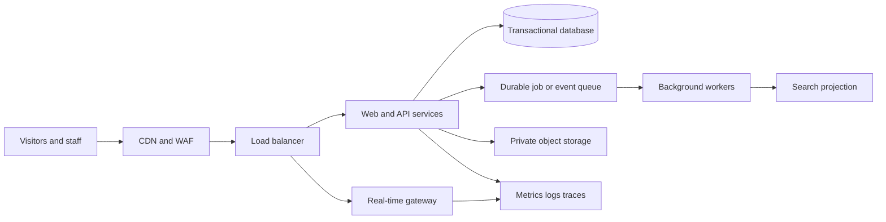

# Infrastructure architecture

| Metadata | Value |
|---|---|
| Document ID | 18/01_INFRASTRUCTURE_ARCHITECTURE |
| Version / status | 0.1 / proposed, not deployed |
| Owner | Platform Architect |
| Reviewers | Architecture, Security, Finance, Operations, QA |
| Updated | 2026-11-15 |
| Scope | Infrastructure architecture for the proposed marketplace. |
| Related | [Discovery baseline](../00_MASTER_INDEX.md); [recovery plan](07_BACKUP_AND_RECOVERY.md). |

## Proposed deployment

Use a managed cloud region chosen only after data residency, latency, provider and legal review. Public traffic reaches DNS, CDN and a web application firewall, then a load balancer and private application services. Separate web/API workers, real-time connection handlers and background jobs by scaling policy while initially retaining the chosen modular application boundaries. The authoritative transactional database runs in private subnets with managed high availability and encrypted backups. Private object storage holds quarantine and approved media; queue, cache and search are non-authoritative supporting systems. Observability and secrets services have isolated access. Administrative ingress requires strong identity and restricted network access.

The diagram omits provider-specific networking and is a proposed topology, not deployed infrastructure. Place workloads across at least two failure zones where supported, use scoped service identity and private endpoints, restrict egress, and separate production accounts from nonproduction. Cross-region failover requires explicit data residency, consistency and budget decisions. The cache and gateway must never determine auction eligibility, price or winner independently of authoritative storage.

## Release and verification

Provisioning should be reproducible and reviewable; this is a design, not a deployment script. Verify network paths, restore, role isolation and degradation with a representative environment. A loss of the queue does not erase a committed transaction; outbox recovery resumes propagation. Failure to determine auction state safely prevents false bid acknowledgements.
