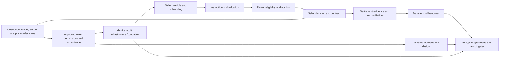

# Dependency Map

| Metadata | Value |
|---|---|
| ID / version | 19/04_DEPENDENCY_MAP / 0.1 |
| Status | Proposed planning estimate; no stakeholder sign-off |
| Owner / reviewers | Program director / product, operations, engineering, finance, legal and QA |
| Updated | 2026-11-15 |
| Purpose and scope | Dependency Map for a proposed English-first marketplace. |

## Critical dependencies

The technical foundation and user research can advance in parallel with decision gathering, but no production launch or implementation-ready declaration follows until applicable P0 decisions are approved. Contracts and finance need actual commercial parties, money movement, tax and ownership-transfer rules; optional provider integration cannot substitute for those decisions. Auction needs a pinned inspection revision and dealer eligibility; consumer listings must have their own publication/availability policy and never expose dealer-only records.

| Dependency | Risk of omission | Mitigation |
|---|---|---|
| Legal jurisdiction and party allocation | Invalid terms or unlicensed activity | Named legal owner, written approved model and market-specific controls. |
| Auction and seller decision policy | Conflicting winner, clock or rejection behavior | Versioned policy, concurrency test and independent operations/legal review. |
| Design/accessibility before frontend sign-off | Unusable or missing error states | Prototype and test critical tasks before code completion. |
| Test data and provider sandboxes | Unverified integration and reconciliation | Contract testing, synthetic records, provider readiness and fault simulation. |
| Branch and support staffing | Technically functioning but unserviceable pilot | Staff training, capacity and escalation drill before onboarding. |

External vendor lead times, legal review, inspection calibration and partner agreements are schedule risks, not assumed completed dependencies.
